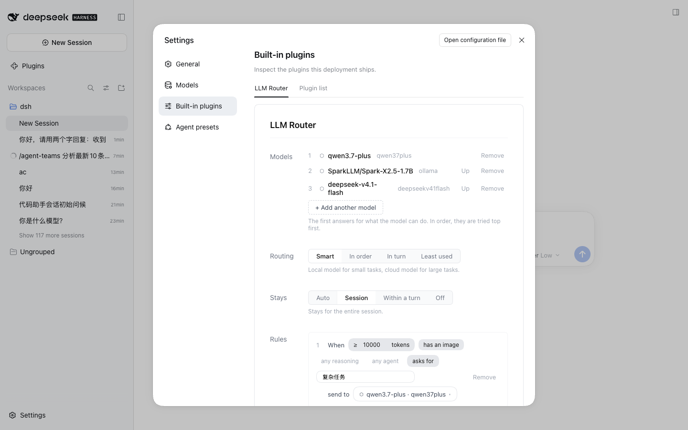
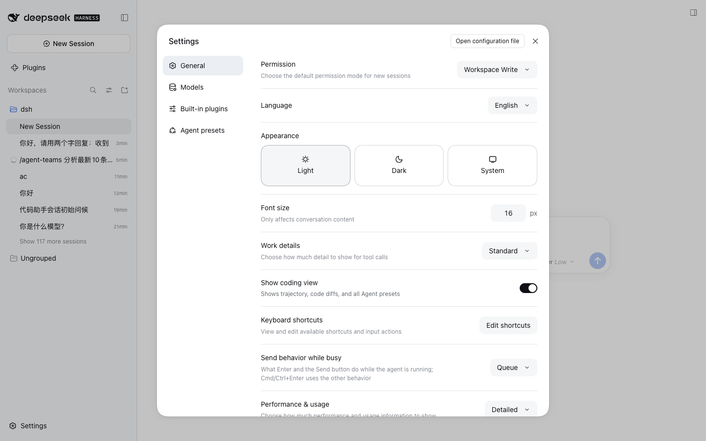

# 安装与验证

演示：通过 `dsh plugin add` 安装插件，确认 Settings UI 正常加载。**含"首次安装必须重启 DSH"的关键验证。**

## 效果截屏





## DSH 版本与依赖

- DeepSeek Harness `>= 0.2.0-rc.2`（web profile）
- Node.js `>= 18`
- 无额外系统依赖

## 如何执行

```bash
# 1. 安装插件（离线 pnpm 操作，会写入 profile 的 package.json + dsh.profile.bundles）
cd ~/.dsh/profiles/web && ./node_modules/.bin/dsh plugin --profile web add github:XHToken/dsh-intelligent-router

# 2. 关键：首次安装必须重启 DSH 进程（不是刷新浏览器）
#    loader entry 和 client bundle 在启动时合成进 boot graph
lsof -ti:3082 | xargs kill -9
cd ~/.dsh/profiles/web && ./node_modules/.bin/dsh web --port 3082

# 3. 用终端打印的带 token URL 打开页面
# 4. Settings → Built-in plugins → 找到 LLM Router
```

## 最终效果

1. ✅ **Built-in plugins** 列表出现 **LLM Router** 条目
2. ✅ 点开后 Settings UI 渲染正常：Route Groups、Strategy、Stays、Rules 面板齐全（对照 `settings-page.png`）
3. ✅ 浏览器 Network 面板能看到 `plugins/??dsh-llm-router/client.js&rev=...` 请求返回 200
4. ❌ **反例验证**：若不重启、只刷新浏览器 → Settings UI 缺失（boot graph 在旧进程启动时已定型，页面里 0 次出现 `dsh-llm-router`）。这正是"装完没反应"的头号原因

## 排障

| 现象 | 原因 | 处理 |
|---|---|---|
| Settings UI 不出现 | 没重启 DSH | 重启进程 |
| 启动报 missing bundle | 安装后未构建 dist（源码安装路径） | `pnpm build` 后复制 dist，再重启 |
| `profile reload requires the root Include entry` | 用 npx 启动 | 改用 profile 本地 bin |
