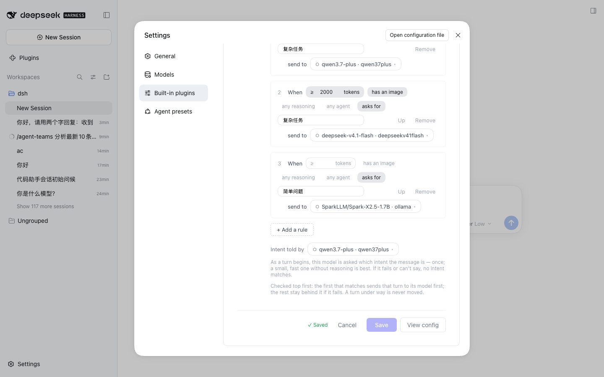

# 配置路由组

演示：在 Settings UI 中给默认路由组添加成员、选择策略与 Stays、保存并确认持久化生效。

## 效果截屏

## DSH 版本与依赖

- DeepSeek Harness `>= 0.2.0-rc.2`（web profile）
- Node.js `>= 18`
- 插件已安装（案例 01）
- DSH 中已配置至少 1 个 provider（Settings UI 的模型选择器从 DSH 已配置模型取数）

## 如何执行

1. 打开 **Settings → Built-in plugins → LLM Router**
2. 点击 **+ Add model**，从 DSH 已配置的 provider 中选择成员（本例：`ollama/SparkLLM/Spark-X2.5-1.7B` + `qwen37plus/qwen3.7-plus` + `deepseekv41flash/deepseek-v4.1-flash`）
3. 选择 **Strategy**（默认 `order`；本例用 `smart`）
4. 选择 **Stays**（`off` / `turn` / `auto` / `session`，默认 `session`）
5. （可选）添加规则：`minTokens` / `hasImage` / `anyAgent` / `intent` 条件 → target 成员
6. 点击 **Save**

> 保存走 `remote.settings.update("llm-router", config, revision)` 乐观并发，最终由 ConfigEditor 覆盖写 profile `cordis.patch.yml` 的 `id: llm-router` 条目 —— **不需要重启**。

## 最终效果

1. ✅ 点击 Save 后出现 **✓ Saved** 提示（`save-result.png`）
2. ✅ 配置即时持久化：`grep -A 30 "id: llm-router" ~/.dsh/profiles/web/cordis.patch.yml` 能看到刚保存的 routeGroups
3. ✅ 刷新页面后配置仍在（经 settings service 读回）
4. ✅ 保存时非法配置会被校验拦截（如空路由组）并提示，不落盘
