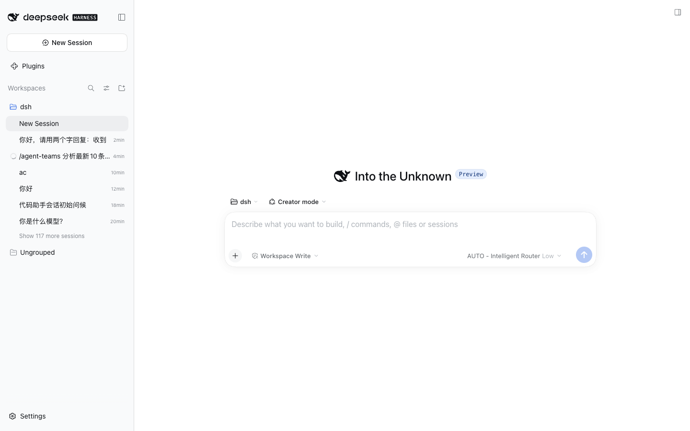
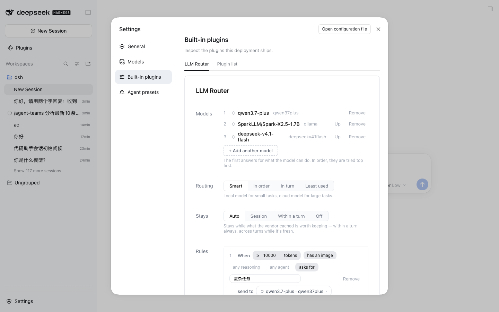
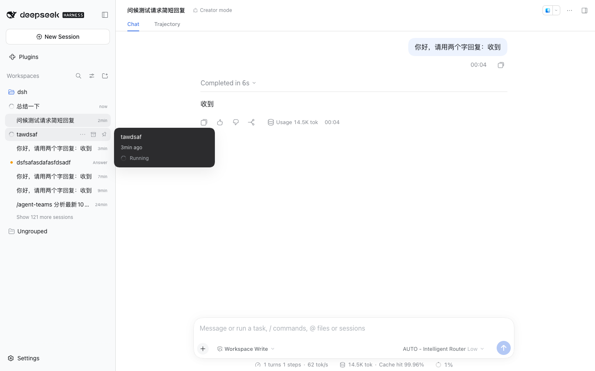
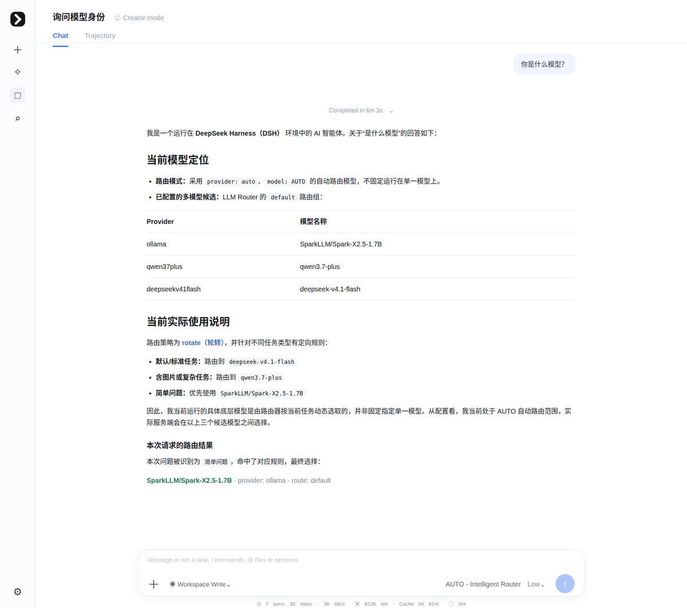

# AUTO 模型路由对话

演示：在聊天中选择 **AUTO – Intelligent Router**，请求经规则/策略路由到组成员，并观察缓存命中。

## 效果截屏









## DSH 版本与依赖

- DeepSeek Harness `>= 0.2.0-rc.2`（web profile）
- Node.js `>= 18`
- 插件已安装（案例 01）+ 路由组已配置（案例 02，至少 1 个可用成员）
- 成员 provider 的 API Key 环境变量已设置（如 `QWEN37PLUS_API_KEY`）

## 如何执行

1. 新建会话，点击输入框右侧模型选择器，选择 **AUTO – Intelligent Router**（可选推理等级 Low / High，默认 Low）
2. 发送一条短消息，如：`你好，请用两个字回复：收到`
3. 观察回复与底部状态栏（token / Cache hit / 耗时）

## 最终效果

1. ✅ 请求正常返回（本例：6s 内回复"收到"）
2. ✅ 底部状态栏显示 **Cache hit 99.96%** —— Stays 缓存亲和生效，连续请求留在上一成功成员
3. ✅ DSH 日志中可见路由决策（`logLevel=debug` 时）：

```bash
tail -100 ~/.dsh/logs/startup-*.log | grep "dsh-llm-router"
# Rule matched / stays hit / candidate 等决策行
```

4. ✅ 指定 group：provider 选 `group/<groupId>` 可只走特定路由组
5. ✅ AUTO 是注册在 DSH 的 provider：任何 DSH 内消费模型的功能（会话标题、意图分类等）都可用它
