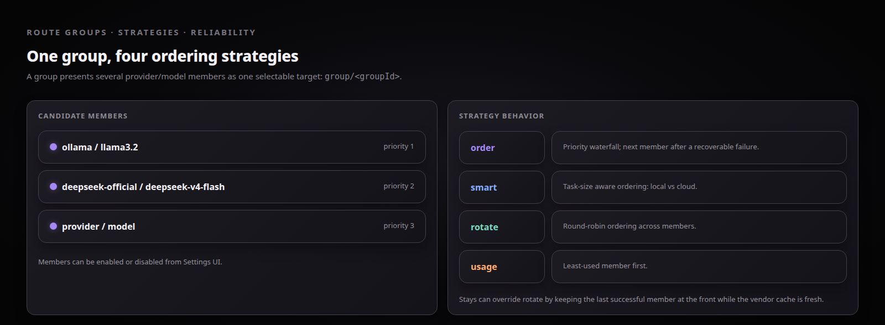
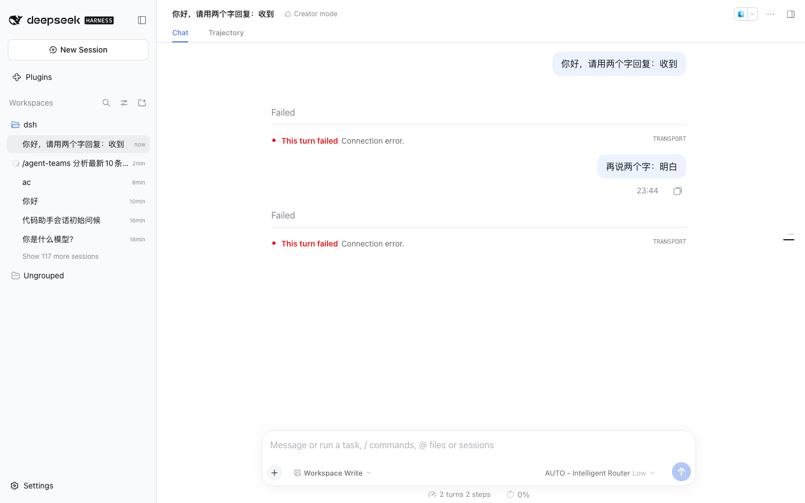

# 策略与 Stays 缓存亲和

演示：4 种路由策略的差异，以及 Stays（`off`/`turn`/`auto`/`session`）如何在策略排序之上做缓存亲和。

## 效果截屏





## DSH 版本与依赖

- DeepSeek Harness `>= 0.2.0-rc.2`（web profile）
- Node.js `>= 18`
- 插件已安装（案例 01）+ 路由组含 ≥ 2 个成员（案例 02）
- `logLevel: debug`（Settings → Advanced）以便观察决策日志

## 如何执行

**策略对比**（路由组里放本地小模型 + 云端大模型各 1 个）：

1. **order**：按成员添加顺序，永远优先第一个
2. **smart**：按任务大小分流 —— 预估 > 4096 tokens 走云端，否则走本地
3. **rotate**：逐请求轮转，观察连续请求落到不同成员
4. **usage**：最少使用优先，连续请求自动找平

**Stays 对比**（同一组，连续发 3 条消息）：

1. `off`：每条请求独立走策略，候选链可能换成员
2. `turn`（~2min 窗）：窗口内上一成功成员置顶
3. `auto`（~5min，对齐 Anthropic prompt cache TTL）：缓存值得保留期间置顶
4. `session`（默认）：整个会话内上一成功成员持续置顶

## 最终效果

1. ✅ debug 日志逐条可见决策：

```bash
tail -f ~/.dsh/logs/startup-*.log | grep "dsh-llm-router"
# smart: "task size > 4096, prefer cloud"；rotate: 交替成员；usage: 最少计数成员
# stays: "stays hit — keeping <provider/model> at front"
```

2. ✅ `session`/`auto` 模式下底部状态栏 **Cache hit** 显著高于 `off`（对照案例 03 的 99.96%）
3. ✅ 亲和成员失败时亲和记录被清除，下一请求回落到策略排序（不会卡死在坏成员）
4. ⚠️ 已知边界：schema 中 `pace`/`weighted`/`intent` 已声明但**未实现**，选了会静默降级为 `order`
