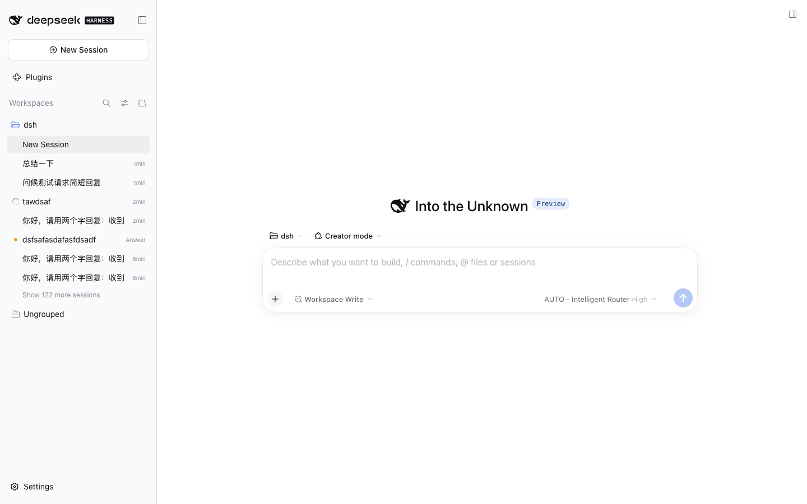
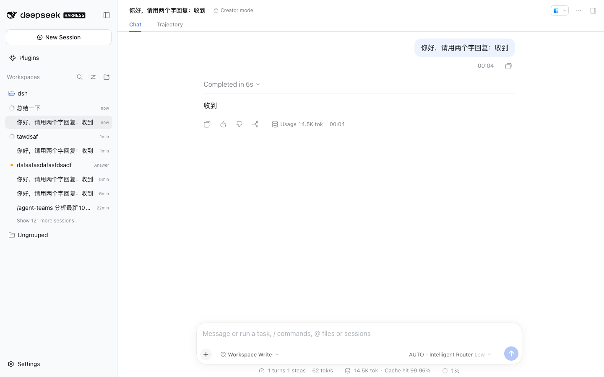

# 自动故障转移

演示：路由组首个成员不可用时，请求自动转移到下一候选，用户无感完成对话。

## 效果截屏





## DSH 版本与依赖

- DeepSeek Harness `>= 0.2.0-rc.2`（web profile）
- Node.js `>= 18`
- 插件已安装（案例 01）+ 路由组含 ≥ 2 个成员（案例 02）
- **人为制造故障**：把首选成员的 provider 弄成不可用（停掉本地 Ollama / 填错 API Key / 断网）
- `logLevel: debug`

## 如何执行

1. 路由组用 `order` 策略，成员 A（本地 ollama）排第一，成员 B（云端）第二
2. **停掉 Ollama**：`brew services stop ollama`（或直接 kill 进程），确认 `curl http://127.0.0.1:11434/v1/models` 失败
3. 在 AUTO 会话发送：`总结一下`
4. 观察：请求不会报错中断，而是静默切到成员 B 完成回复
5. 恢复 Ollama，发下一条消息 → 回到成员 A（Stays 亲和随失败记录清除后重新建立）

## 最终效果

1. ✅ 对话正常完成（`after-failover.png`：失败成员被跳过，回复正常返回）
2. ✅ debug 日志可见三级分类与转移：

```bash
grep "dsh-llm-router" ~/.dsh/logs/startup-*.log | grep -iE "fallback|failover|router"
# 连接错误（ECONNREFUSED / "Connection error." / fetch failed）→ TRANSIENT → 切下一候选
# router/fallback 事件同时被 emit（host 端观测点）
```

3. ✅ **安全边界验证**（不应 fallback 的场景，需单独验证）：
   - API Key 错误（401/403）→ PERMANENT，**立即报错不重试**，不浪费重试次数
   - 配额超限 → 配额守卫直接跳过该成员，不消耗 retry
4. ✅ `maxRetries: 3` 语义 = **总共 3 次尝试**（含首次），不是 1+3
5. ✅ 恢复后的成员在下一请求可被重新选中
