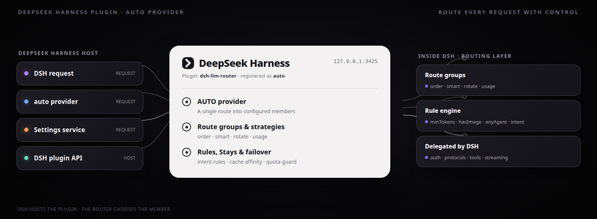
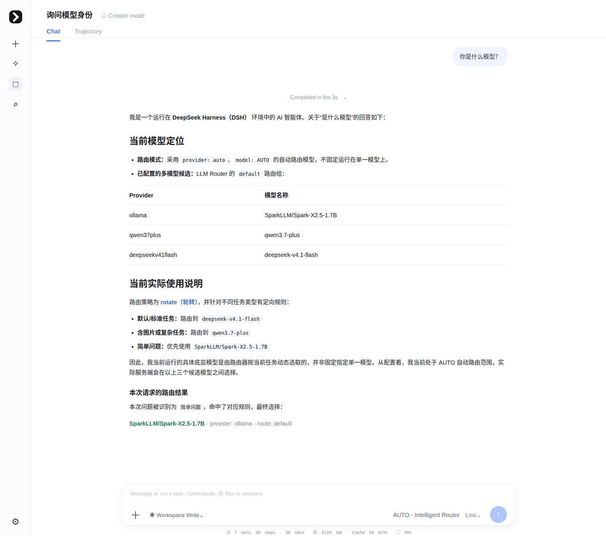
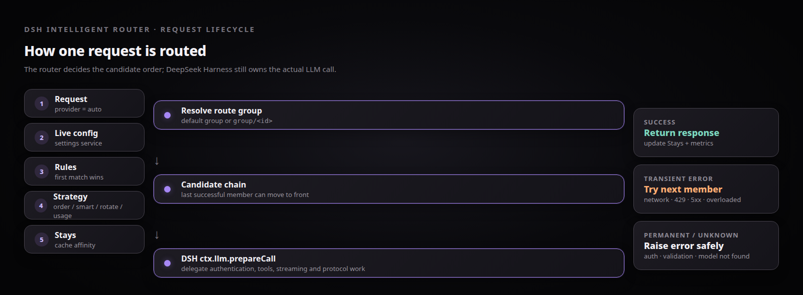
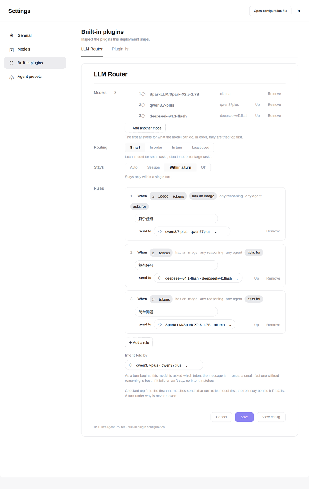
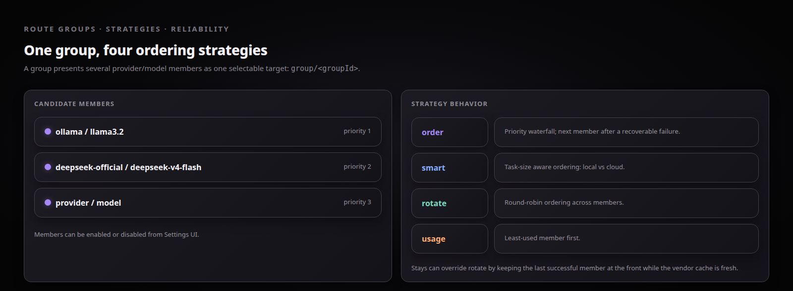

# DSH Intelligent Router

> Intelligent LLM routing for [DeepSeek Harness](https://github.com/deepseek-ai/deepseek-harness) (DSH) — Multi-model Routing Strategies, Automatic Failover, Cache-affinity Staying, Data Anonymization and a Visual Settings UI.

[](https://github.com/XHToken/dsh-intelligent-router/actions/workflows/ci.yml)
[](https://github.com/XHToken/dsh-intelligent-router/actions/workflows/ci.yml)
[]()
[](https://github.com/XHToken/community/blob/main/LICENSE)
[](https://github.com/deepseek-ai/deepseek-harness)
[](https://discord.gg/yxesrcfy7)

The router registers itself as the **`auto`** provider in DSH. Pick **AUTO – Intelligent Router** as your model and every request is routed to the best member of your configured route group — with rules, strategies, failover, and prompt-cache-aware staying working under the hood.

## Architecture

<p align="center">
  
</p>

> DSH Intelligent Router registers as the `auto` provider in DeepSeek Harness and routes each request through configurable route groups, strategies, intent rules, cache-affinity Stays, and automatic failover.

---

## Usage demo

The screenshot below shows a real DSH chat flow with `AUTO - Intelligent Router`: the request is classified, matched against routing rules, and served by the selected provider/model member.

<p align="center">
  
</p>

## Routing details

### Request lifecycle

<p align="center">
  
</p>

### Settings and live persistence

<p align="center">
  
</p>

### Strategies, route groups, and Stays

<p align="center">
  
</p>

## Features

### Routing
- **Route groups** — organize members (provider + model) and manage them from the Settings UI
- **Four routing strategies** — `order` (priority) · `smart` (task-size aware: local vs cloud) · `rotate` (round-robin) · `usage` (least-used first)
- **Rule engine** — `minTokens` / `hasImage` / `anyAgent` / `intent` conditions; the first matching rule pins its target model to the front of the candidate chain
- **Intent routing** — a lightweight classifier model (your choice) labels the message intent; rules route on it
- **Stays (cache affinity)** — `off` / `turn` / `auto` / `session` (default `session`): keeps the last successful member at the front while the vendor prompt cache is worth keeping, keyed per DSH session

### Reliability
- **Automatic failover** — three-tier error classification (TRANSIENT / PERMANENT / UNKNOWN), no false positives: auth and validation errors never burn retries; connection, rate-limit, and 5xx errors fall through to the next candidate
- **Quota guard** — members that exceed limits are skipped without consuming a retry

### Experience
- **Settings UI** (Magpie-style, zh/en) — model picker fed from DSH's configured models, strategy pills, rule builder, intent-classifier selection, save-time validation, live persistence via the DSH settings service
- **Observability** — per-group/per-member metrics, latency tracking, cost estimates, and `router/fallback` events (host side)

## Requirements

- [DeepSeek Harness](https://github.com/deepseek-ai/deepseek-harness) `>= 0.2.0-rc.2` (declared in [`compatibility.json`](compatibility.json))
- [Node.js](https://nodejs.org/en) `>= 18` (DSH runtime), pnpm for development

## Installation

```bash
# Via DSH (recommended)
dsh plugin --profile web add github:XHToken/dsh-intelligent-router

# Or build from source
git clone https://github.com/XHToken/dsh-intelligent-router.git
cd dsh-intelligent-router
pnpm install && pnpm build
cp -r dist/* ~/.dsh/profiles/web/node_modules/dsh-llm-router/dist/
cp cordis.patch.yml compatibility.json ~/.dsh/profiles/web/node_modules/dsh-llm-router/
```

> [!WARNING]
> **First-time install requires a DSH restart.** The plugin's loader entry and client bundle are composed into the boot graph **at server startup**. 
> If DSH is already running when you install, it will not notice the new package — the Settings UI (and the `auto` provider) will be missing until you restart.
> Stop the running `dsh web` process and start it again; a browser reload alone is not enough. Subsequent changes to routing config (Save in the Settings UI) or rebuilt plugin bundles are picked up live via HMR — only package-level install/remove needs a restart.
> **Waiting for DSH support in the future.**

> Start DSH from the profile directory with the **local binary** (`cd ~/.dsh/profiles/web && ./node_modules/.bin/dsh web --port 3082`). Launching via `npx` can load a duplicate module tree and break settings writes.

## Quick Start

1. Start DSH and open **Settings → Built-in plugins → LLM Router**
2. Click **+ Add model** to pick members from your DSH-configured providers
3. Choose a strategy (default: `order`); optionally add rules
4. Click **Save** (persists immediately via the DSH settings service)
5. In chat, select **AUTO – Intelligent Router** — done

Use a specific group with provider `group/<groupId>`.

## Configuration Reference

Persisted by the Settings UI into the profile's `cordis.patch.yml` (`id: llm-router`). A minimal example:

```yaml
- id: llm-router
  name: 'dsh-llm-router'
  config:
    enabled: true
    defaultGroup: 'default'
    routeGroups:
      - id: 'default'
        name: 'Default'
        strategy: 'order'          # order | smart | rotate | usage
        stays: 'session'           # off | turn | auto | session
        enabled: true
        members:
          - provider: 'ollama'
            model: 'SparkLLM/Spark-X2.5-1.7B'
            priority: 1
            enabled: true
            protocol: 'openai-responses'
          - provider: 'qwen37plus'
            model: 'qwen3.7-plus'
            priority: 2
            enabled: true
            protocol: 'anthropic-messages'
          - provider: 'deepseekv41flash'
            model: 'deepseek-v4.1-flash'
            priority: 3
            enabled: true
            protocol: 'openai-responses'
        classifierModel:            # used by intent rules
          provider: 'ollama'
          model: 'SparkLLM/Spark-X2.5-1.7B'
        rules:
          - minTokens: 10000
            hasImage: true
            intent: '复杂问题'
            target: { provider: 'qwen37plus', model: 'qwen3.7-plus' }
          - minTokens: 2000
            intent: '复杂问题'
            target: { provider: 'deepseekv41flash', model: 'deepseek-v4.1-flash' }
          - intent: '简单问题'
            target: { provider: 'ollama', model: 'SparkLLM/Spark-X2.5-1.7B' }
    fallback:
      enabled: true
      maxRetries: 3                 # total attempts per request
      retryDelay: 1000
    quotaTracking:
      enabled: true
```

See [cordis.patch.yml.example](cordis.patch.yml.example) for the full annotated schema.

## Documentation

- [Routing Strategies & Rule Engine](docs/routing-strategies.md)
- [Magpie Integration Design](docs/magpie-integration.md)
- [Settings UI Design](docs/sample-settings-ui.md)
- [DeepSeek Harness Architecture Analysis](docs/deepseek-harness-analysis.md)
- [Usage examples](examples/) — reproducible cases with screenshots (agent-teams, coding, document pipeline, data anonymization, image redesign), indexed by the [`dsh-router-examples`](.agents/skills/dsh-router-examples/) skill

## Development

```bash
pnpm install
pnpm run build        # tsup + ModuleLoader wrap
pnpm run typecheck    # tsc --noEmit
pnpm run lint         # eslint
pnpm test:run         # vitest (194 tests)
pnpm run doctor       # self-check a DSH installation (host version, plugin tree)
```

CI runs the quality pipeline on every push, and an [E2E workflow](.github/workflows/e2e.yaml) installs the plugin into a real DSH host afterwards (boot → restart → Settings UI bundle contract → doctor).

## Roadmap

- `pace` / `weighted` / `intent` strategies are declared in the schema but **not implemented** (they silently degrade to `order`) — implement or prune
- Stays windows (`turn` ≈ 2 min, `auto` ≈ 5 min) are hardcoded approximations — make configurable
- Quota limits are hardcoded (1M tokens/day, 1k requests/day) and never auto-reset — wire up `quotaTracking.limits`
- Monitoring data has no UI channel yet (panel shows mock data)
- Middleware system is implemented but not wired into the request path
- Prune the legacy dual call path (`route()` waterfall / `llm-client.ts`)

## Contributing

Contributions are welcome — see [CONTRIBUTING.md](CONTRIBUTING.md). Please read the [Code of Conduct](CODE_OF_CONDUCT.md) first. For security issues, see [SECURITY.md](SECURITY.md).

## References

- [magpie](https://github.com/yetone/magpie) — the Settings UI and routing strategy design of this project were inspired by and reference this project. Many thanks to the author.

## License

Licensed under the [XHToken community license](https://github.com/XHToken/community/blob/main/LICENSE). See [LICENSE](LICENSE) for the full text.
