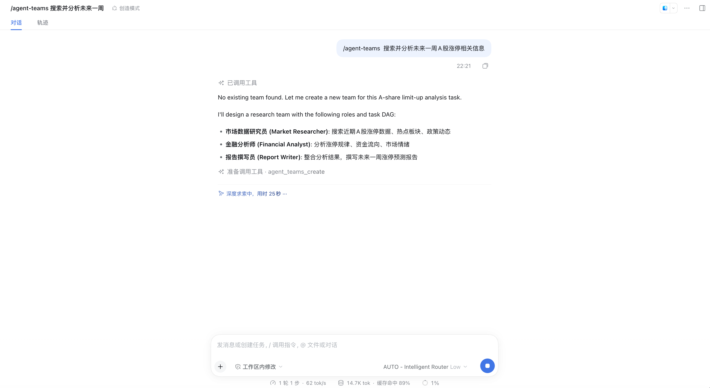
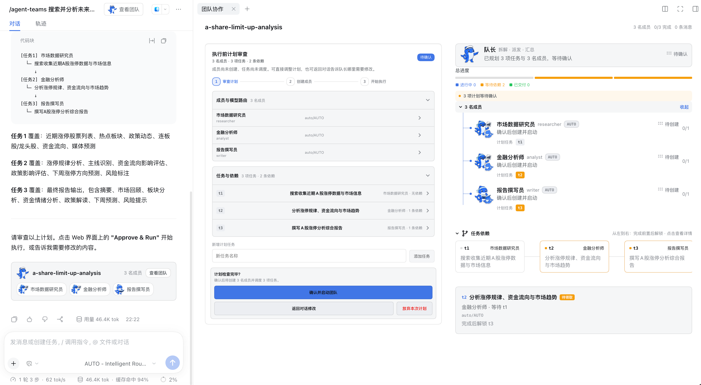
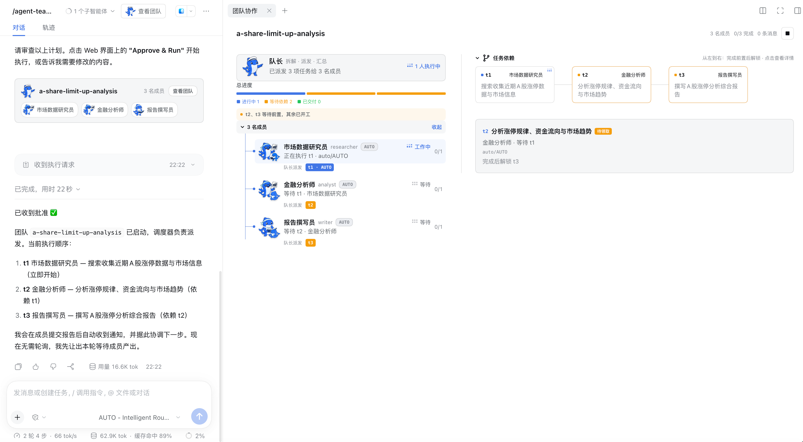
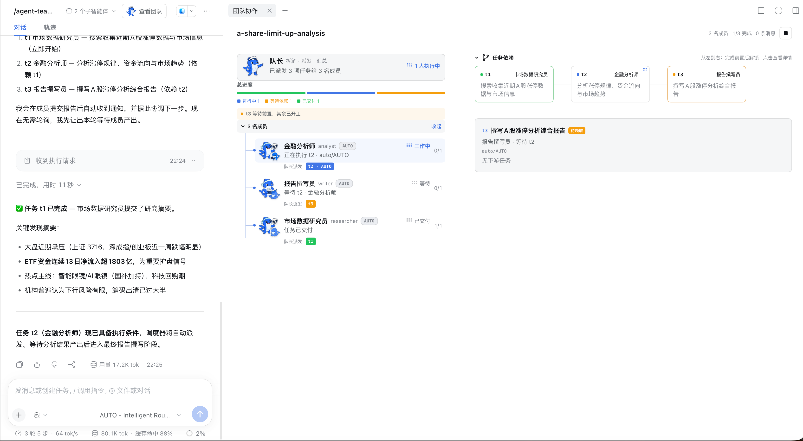
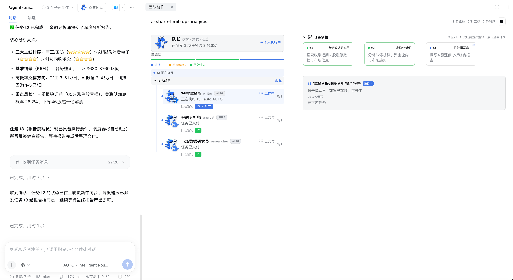
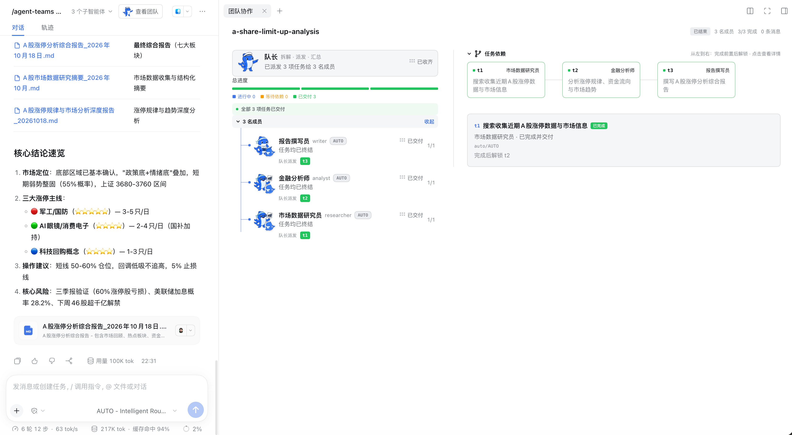
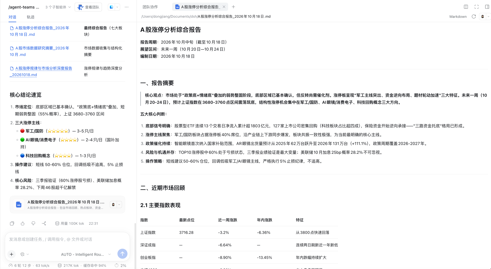

# Agent-Teams 多智能体协作 × AUTO 路由

演示：`/agent-teams` 组建多角色团队完成复杂研究任务，**所有成员的模型调用都经由 AUTO – Intelligent Router 路由**——多智能体编排与智能路由联动的端到端场景。

**任务 query**：`/agent-teams 搜索并分析未来一周A股涨停相关信息`

## 效果截屏（按时间线）

### 1. 发起任务与团队设计

队长自动拆解出 3 个角色与任务 DAG：市场数据研究员 / 金融分析师 / 报告撰写员。

### 2. 执行前计划审查（Approve & Run）

计划审查面板：**3 名成员的模型路由全部为 `auto/AUTO`**——即每个子智能体不绑定固定模型，由路由器按策略/规则/Stays 分配。任务依赖 t1 → t2 → t3 可视化呈现。

### 3. 批准后团队启动

调度器按依赖派发：t1（市场数据研究员）立即开工，t2/t3 等待前置。

### 4. t1 交付，t2 接力

研究员提交结构化研究摘要（指数表现、ETF 资金流入 1803 亿、热点主线），调度器自动解锁并派发 t2 给金融分析师。

### 5. t2 交付，t3 接力

分析师提交深度分析（三大主线排序、涨停方向预测、风险标注），报告撰写员开始撰写最终综合报告（2/3 完成）。

### 6. 全部交付

3/3 任务完成，产出 3 份 Markdown 交付物，队长汇总核心结论（市场定位、三大涨停主线、操作建议、核心风险）。

### 7. 最终报告

最终综合报告在 DSH 内直接渲染为 Markdown 预览（七大板块：摘要、市场回顾、板块分析、资金情绪、政策解读、下周预测、风险提示）。

## DSH 版本与依赖

- DeepSeek Harness `>= 0.2.0-rc.2`（web profile）
- Node.js `>= 18`
- **`@nanmicoder/dsh-agent-teams`** 插件（`dsh plugin --profile web add @nanmicoder/dsh-agent-teams`）
- **`dsh-llm-router`**（案例 01）+ 路由组含 ≥ 2 个成员（案例 02）—— 成员路由为 `auto/AUTO` 时所有子智能体走路由器
- 成员 provider 的 API Key 环境变量已设置；本例研究员任务触发**深度搜索**，需 provider 支持联网/搜索
- 用 profile 本地 bin 启动（通用前置条件见 [.agents/skills/dsh-router-examples/examples/README.md](../../.agents/skills/dsh-router-examples/examples/README.md)）

## 如何执行

1. 确认路由组已配置（案例 02），模型选择器可见 **AUTO – Intelligent Router**
2. 新会话输入：`/agent-teams 搜索并分析未来一周A股涨停相关信息`
3. 队长输出角色与任务 DAG → 在**计划审查**面板确认成员路由（auto/AUTO）与依赖关系 → 点击 **确认并启动团队**
4. 观察团队协作面板：总进度条、成员状态（工作中/等待/已交付）、任务依赖图从左到右解锁
5. 全程无需干预：t1 交付自动解锁 t2，t2 交付自动解锁 t3，队长汇总后交付

## 最终效果

1. ✅ **全部 3 名成员的调用都经由路由器**：成员卡片的 `auto/AUTO` 徽标 + 输入框模型选择器始终为 AUTO – Intelligent Router
2. ✅ 任务 DAG 按依赖顺序执行：t1（搜集）→ t2（分析）→ t3（报告），前置完成后自动解锁，无轮询
3. ✅ 产出 3 份 Markdown 交付物（研究摘要 / 深度分析 / 综合报告），综合报告含完整七大板块
4. ✅ **缓存亲和在长协作中持续生效**：底部状态栏缓存命中 88% → 94% 逐轮走高（117K → 217K tok 全程），多轮多成员的上下文大量命中 prompt cache
5. ✅ debug 日志可交叉验证：每个子智能体的请求都出现 router 决策行（策略/Stays/fallback），而不是固定打到某一 provider

## 联动要点

| 关注点 | 行为 |
|---|---|
| 成员路由 `auto/AUTO` | agent-teams 不绑定模型，每个成员的每次调用都走路由器候选链 |
| Stays 亲和 | 连续任务调用尽量留在同一成员，是缓存命中逐轮走高的直接原因 |
| 故障转移 | 某成员调用的 provider 中途失败时由路由器静默切换，团队编排无感（见案例 05） |
| 推理等级 | AUTO 支持 Low/High；复杂分析任务可切 High |
