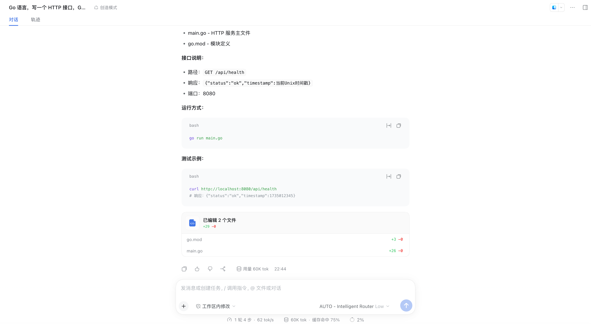
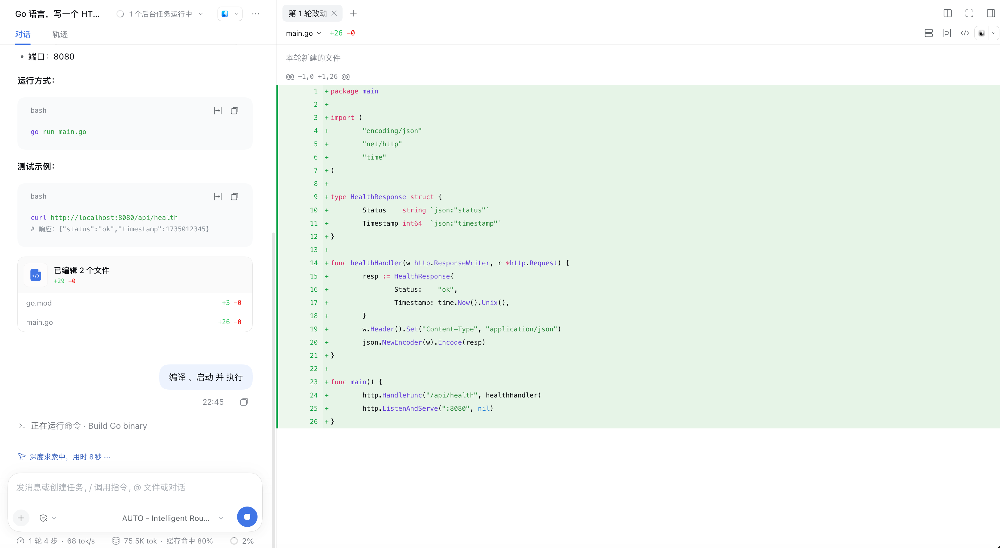
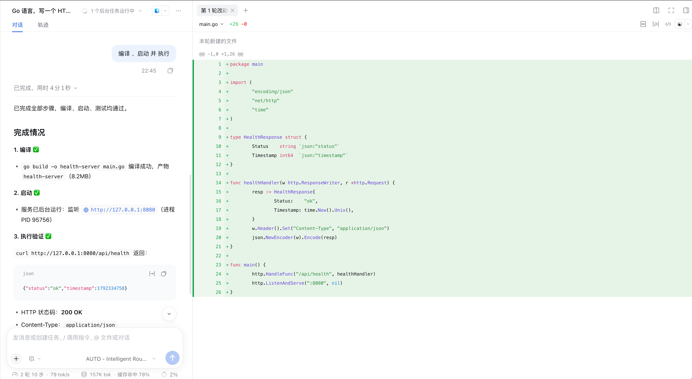
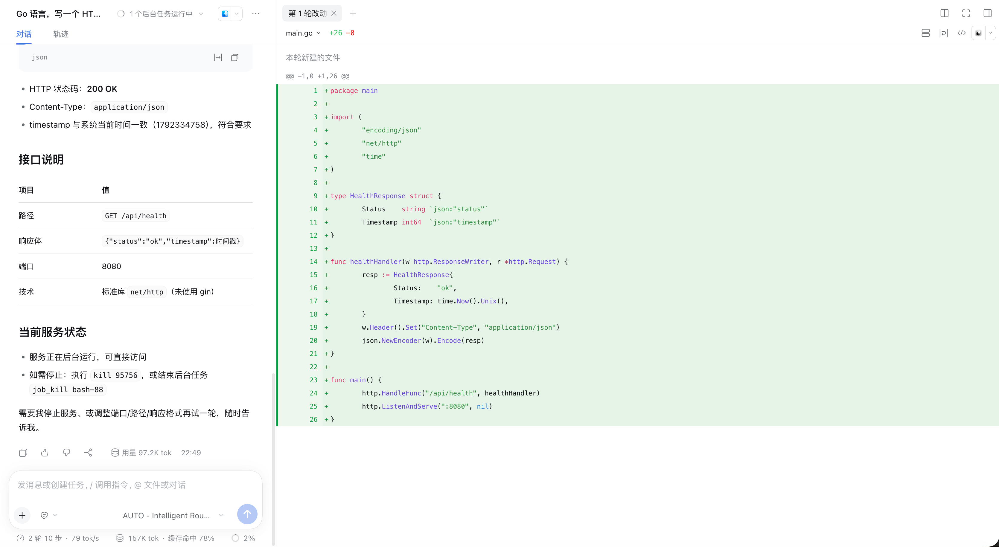

# Coding：生成代码 → 编译 → 启动 → 运行验证

演示：单轮对话完成一个真实编码任务 —— 生成 Go HTTP 服务代码并**直接写入工作区文件**，再一键编译、后台启动、curl 验证，全程模型调用经由 AUTO – Intelligent Router。

**任务 query**：

> Go 语言，写一个 HTTP 接口，GET /api/health，返回 json `{"status":"ok","timestamp": 当前时间戳}`，使用标准库 net/http，不要 gin。

## 效果截屏（按时间线）

### 1. 发送需求，模型开始写文件

模型路由为 AUTO – Intelligent Router Low，深度求索后直接写入 `/Users/dongjiang/Documents/dsh/main.go`。

### 2. 首轮交付：代码 + 文档 + 改动统计

回复包含接口说明、运行方式、测试示例，并给出 **已编辑 2 个文件 +29 −0**（`go.mod` +3、`main.go` +26）的改动统计。

### 3. Diff 视图审查 + 第二轮指令

右侧面板逐行展示新建文件的完整 diff，确认无误后发送「编译、启动 并 执行」。

### 4. 编译 / 启动 / 验证 三步全绿

- **编译 ✅**：`go build -o health-server main.go`，产物 8.2MB
- **启动 ✅**：后台监听 `http://127.0.0.1:8080`（PID 95756）
- **执行验证 ✅**：`curl` 返回 `{"status":"ok","timestamp":1792334758}`，HTTP 200，`Content-Type: application/json`

### 5. 最终汇总

接口说明表（路径 / 响应体 / 端口 / 技术栈：**标准库 net/http，未使用 gin** —— 约束被严格遵守），以及服务运行状态与停止方式。

## DSH 版本与依赖

- DeepSeek Harness `>= 0.2.0-rc.2`（web profile）
- Node.js `>= 18`
- 插件已安装（案例 01）+ 路由组含可用成员（案例 02），模型选择器选 **AUTO – Intelligent Router**
- **工作区写权限**：输入框左侧为「工作区内修改」模式，会话绑定工作区目录（本例 `~/Documents/dsh`）
- **本案例工具链**：Go toolchain（`go build` / `go run`）；其他语言换成对应工具链即可，流程相同
- 用 profile 本地 bin 启动（通用前置条件见 [.agents/skills/dsh-router-examples/examples/README.md](../../.agents/skills/dsh-router-examples/examples/README.md)）

## 如何执行

1. 选择或新建工作区（本例 `~/Documents/dsh`），模型选择器选 **AUTO – Intelligent Router**
2. 发送编码需求（见上方 query；「不要 gin」这类约束可自由替换）
3. 首轮回复后，在右侧 diff 面板逐文件审查改动
4. 发送「编译、启动 并 执行」，观察三步进度
5. 验证通过后按汇总中的方式停止服务（`kill <PID>` 或 `job_kill`）

## 最终效果

1. ✅ **文件真实落盘**：`main.go` / `go.mod` 写入工作区，diff 面板 +29 −0 与文件实际内容一致
2. ✅ **编译、启动、执行验证三项全绿**：curl 实测返回预期 JSON，HTTP 200 + 正确 Content-Type，timestamp 与系统时间一致
3. ✅ **约束被严格遵守**：全程使用标准库 `net/http`，无 gin 依赖
4. ✅ **路由证据**：两轮共 157K tok，底部状态栏缓存命中 75% → 80%（编码类长上下文多轮交互持续命中 prompt cache）；模型选择器全程为 AUTO，说明生成/编译/验证各阶段调用都由路由器分配
5. ✅ **可继续迭代**：同一会话内改端口 / 路径 / 响应格式再试一轮，上下文亲和保持命中

## 与其他案例的关系

| 案例 | 本案例复用点 |
|---|---|
| 03 AUTO 路由对话 | 相同的 AUTO 选择与路由链路，这里负载是代码生成而非问答 |
| 04 策略与 Stays | 多轮长上下文正是 Stays 缓存亲和收益最大的场景（75%→80%） |
| 06 Agent-Teams | 复杂编码任务可升级为 `/agent-teams` 多角色协作（设计/实现/测试） |
