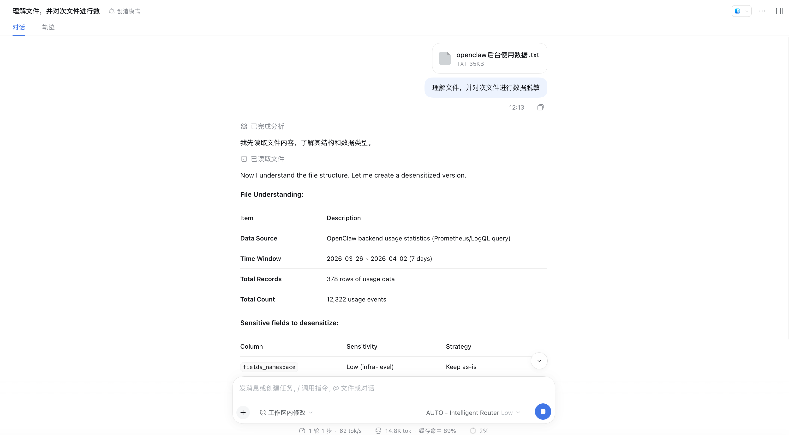
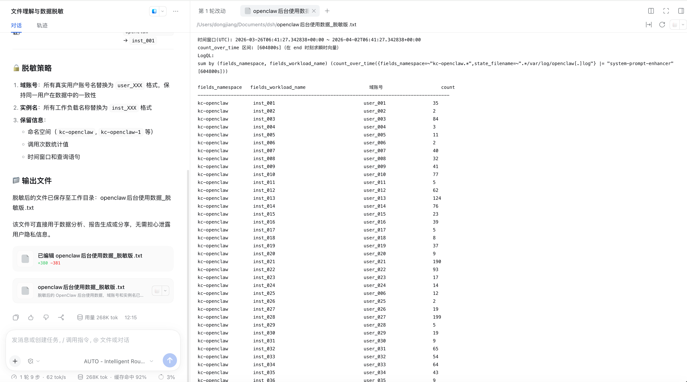
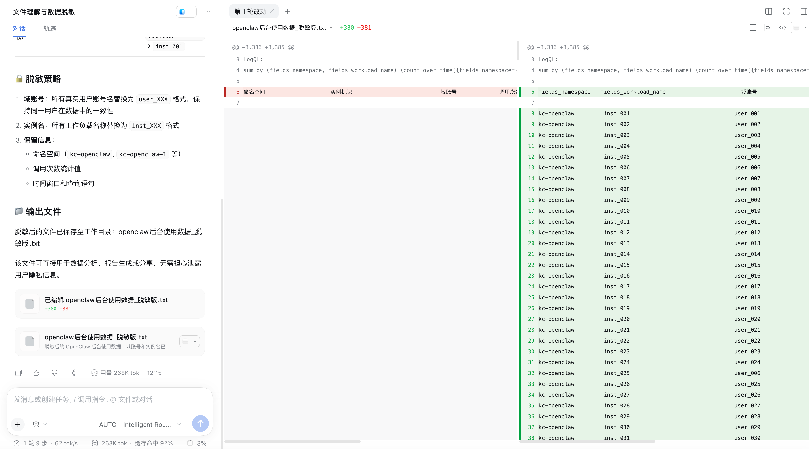

# 数据脱敏：理解文件结构 → 敏感字段分级 → 整文件匿名化

演示：上传一份含真实用户身份与实例标识的后台统计数据（TXT，35KB），模型先**理解文件结构**，对敏感字段按敏感度分级并给出脱敏策略，再产出整文件脱敏版——对应 README 特性中的 **Data Anonymization**。全程模型调用经由 AUTO – Intelligent Router。

**任务**：上传附件 `openclaw后台使用数据.txt`，发送：

> 理解文件，并对次文件进行数据脱敏

## 效果截屏（按时间线）

### 1. 文件理解与敏感字段分级

先读取文件，输出结构化理解：数据来源（OpenClaw 后台 Prometheus/LogQL 查询）、时间窗口（7 天）、378 行记录 / 12,322 次使用事件；随后对每一列做敏感度分级与策略建议（如 `fields_namespace` = Low 基础设施级 → 保留原样）。

### 2. 脱敏执行与策略说明

- **域账号**（用户身份）：330 个，`qiwang59` → `user_001` 格式
- **实例名**（工作负载）：378 个，`openclaw-instance-01ysnz-openclaw` → `inst_001` 格式
- **保留信息**：命名空间、调用次数统计值、时间窗口与查询语句

脱敏版文件直接写入工作区：`openclaw后台使用数据_脱敏版.txt`（+380 −381）。

### 3. 脱敏版文件预览

表头与数据行全部匿名化：`fields_workload_name` = inst_XXX，域账号列 = user_XXX，统计值原样保留，LogQL 查询语句完整保留。

### 4. 前后对照 diff

左右双栏 diff：左侧原文（真实实例标识 / 域账号），右侧脱敏版（inst_XXX / user_XXX），逐行可核对替换范围。

## DSH 版本与依赖

- DeepSeek Harness `>= 0.2.0-rc.2`（web profile）
- Node.js `>= 18`
- 插件已安装（案例 01）+ 路由组含可用成员（案例 02），模型选择器选 **AUTO – Intelligent Router**
- **附件上传**（本例 TXT，同样适用于 CSV/JSON/日志等结构化文本）+ 工作区写权限
- 用 profile 本地 bin 启动（通用前置条件见 [.agents/skills/dsh-router-examples/examples/README.md](../../.agents/skills/dsh-router-examples/examples/README.md)）

## 如何执行

1. 新会话（绑定工作区），模型选择器选 **AUTO – Intelligent Router**
2. 上传含敏感字段的文本附件，发送「理解文件，并对次文件进行数据脱敏」
3. 审查首轮输出的**敏感字段分级表**——确认哪些列脱敏、哪些保留符合预期（不符合可直接对话调整策略）
4. 核对脱敏版文件与 diff：真实身份 → user_XXX / inst_XXX，统计值与查询语句保留
5. 脱敏版文件可直接用于分析、报告或外发分享

## 最终效果

1. ✅ **分级合理**：用户身份（域账号）、工作负载（实例名）被识别为敏感并匿名化；基础设施级命名空间、统计值、查询语句判定为可保留——不是无差别打码
2. ✅ **一致性保证**：同一真实账号在全文 330 处映射到**同一个** `user_XXX`（378 实例同理），脱敏后数据仍可做关联分析，不破坏统计语义
3. ✅ **可审计**：前后 diff 逐行对照（+380 −381），替换范围一目了然；268K tok、缓存命中 89%→92%
4. ✅ **产物即用**：`openclaw后台使用数据_脱敏版.txt` 落盘工作区，可直接进入下游分析/分享流程

## 与其他案例的关系

| 案例 | 对比点 |
|---|---|
| document-pipeline | 同为附件处理：那边是 PDF 多阶段流水线 + 6 并行子智能体；本例是单文件单轮的结构化改写，负载更轻 |
| coding | 同为工作区落盘：coding 生成新代码；本例产出原文的匿名化派生文件，原文不被改动 |
