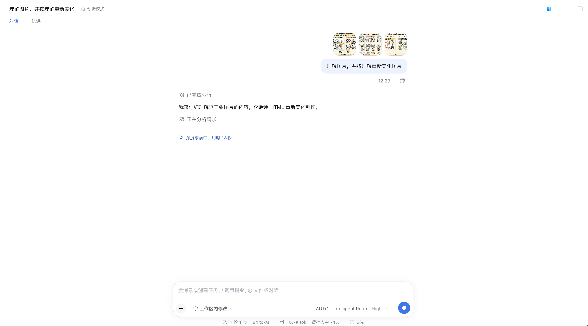
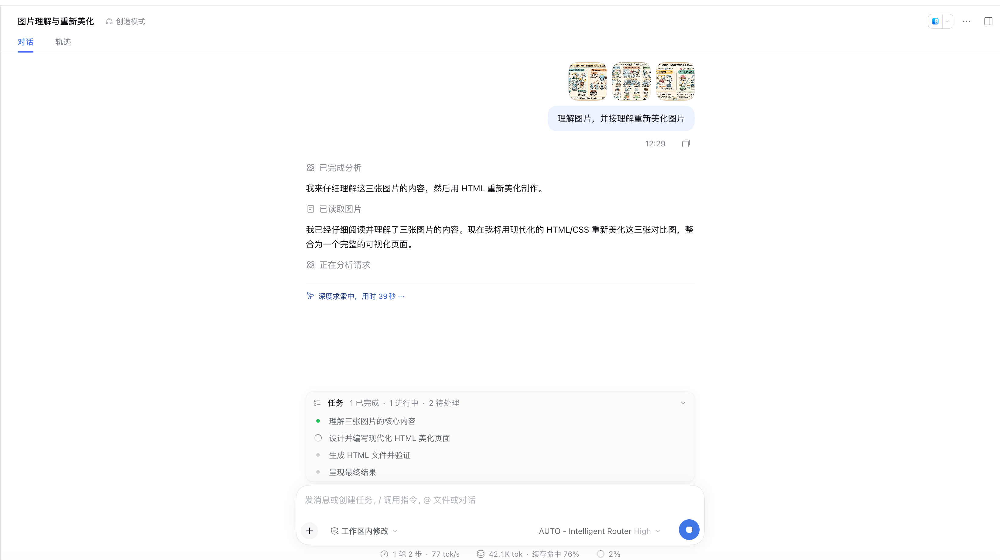
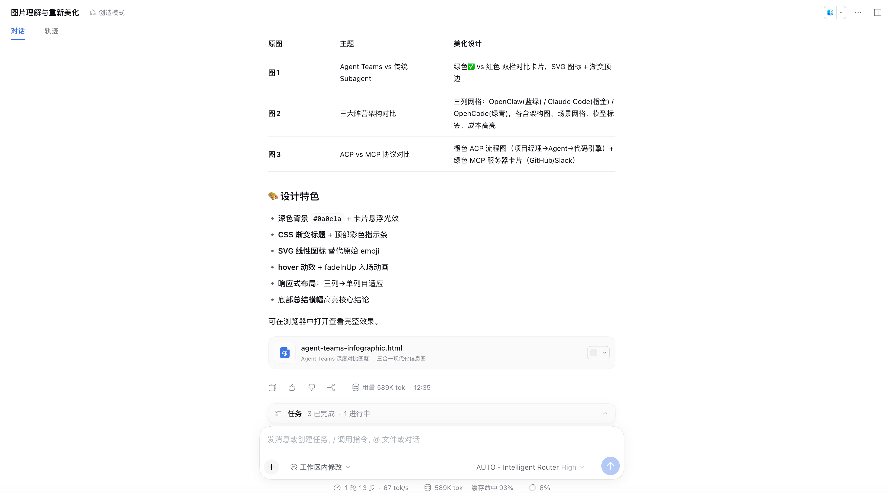
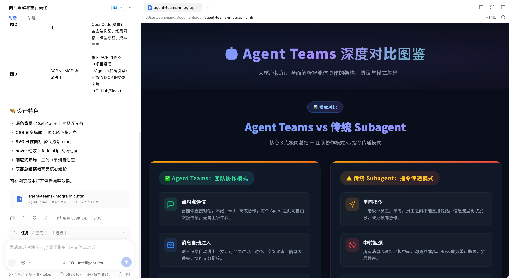

# 图片理解与重新美化：3 张手绘信息图 → 现代化 HTML 可视化页面

演示：一次上传 3 张手绘风格信息图，模型**逐张理解内容与主题**，再用现代化 HTML/CSS 重新美化制作，整合为一个可直接在浏览器打开的可视化页面。注意本案例使用推理等级 **High**——与其余案例的 Low 形成对照，适合"理解 + 创作"类负载。全程模型调用经由 AUTO – Intelligent Router。

**任务**：上传 3 张图片（Agent Teams 对比图），发送：

> 理解图片，并按理解重新美化图片

## 效果截屏（按时间线）

### 1. 上传 3 张图并下达指令

模型选择器为 **AUTO – Intelligent Router High**。首轮即明确工作路径：仔细理解三张图的内容，然后用 HTML 重新美化制作。

### 2. 图片理解完成，任务清单展开

图片读取后输出理解结论，并列出任务清单：理解核心内容（✅）→ 设计并编写现代化 HTML 美化页面（进行中）→ 生成 HTML 文件并验证 → 呈现最终结果。

### 3. 逐图设计方案 + 交付物

每张原图对应一份美化设计：图 1 Agent Teams vs 传统 Subagent → 绿/红双栏对比卡片（SVG 图标 + 渐变顶边）；图 2 三大阵营架构对比 → 三列网格（OpenClaw/Claude Code/OpenCode，含架构图与成本高亮）；图 3 ACP vs MCP 协议对比 → 流程图 + 服务器卡片。设计特色：深色背景 `#0a0e1a`、CSS 渐变标题、SVG 线性图标、hover/fadeInUp 动效、响应式布局。交付物 `agent-teams-infographic.html`。

### 4. HTML 渲染预览

产物在 DSH 内直接渲染：深色主题、渐变标题「Agent Teams 深度对比图鉴」、绿/红双栏对比卡片、SVG 图标——原始手绘信息被完整转译为现代可视化语言。

## DSH 版本与依赖

- DeepSeek Harness `>= 0.2.0-rc.2`（web profile）
- Node.js `>= 18`
- 插件已安装（案例 01）+ 路由组含可用成员（案例 02），模型选择器选 **AUTO – Intelligent Router**，**推理等级 High**
- 多图附件上传（本例 3 张 PNG）+ 工作区写权限
- 用 profile 本地 bin 启动（通用前置条件见 [.agents/skills/dsh-router-examples/examples/README.md](../../.agents/skills/dsh-router-examples/examples/README.md)）

## 如何执行

1. 新会话（绑定工作区），模型选择器选 AUTO 并切换推理等级为 **High**
2. 一次选中多张图片上传，发送「理解图片，并按理解重新美化图片」
3. 审查逐图理解结论与设计对照表——主题识别错误可在下一轮指正
4. 等待 HTML 生成（本例 589K tok、约 6 分钟），在 DSH 内预览或浏览器打开 `agent-teams-infographic.html`
5. 不满意可继续对话迭代配色/布局/文案

## 最终效果

1. ✅ **三张图全部被正确理解**：主题（Agent Teams vs Subagent / 三大阵营架构 / ACP vs MCP 协议）逐张识别，并各配一份独立美化方案
2. ✅ **交付物可用**：单文件 `agent-teams-infographic.html` 整合三图内容，深色主题 + 渐变 + SVG + 动效 + 响应式，浏览器直接打开
3. ✅ **信息保真**：原图的对比关系、阵营配色、流程走向在重新设计中都被保留并强化，不是凭空重画
4. ✅ **High 等级的路由证据**：全程 AUTO High，缓存命中 71%→93% 逐轮走高（589K tok），理解与生成阶段的调用都由路由器分配

## 与其他案例的关系

| 案例 | 对比点 |
|---|---|
| coding | 同为生成可运行产物：coding 是代码 + 编译验证；本例是 HTML 单文件 + 浏览器预览 |
| document-pipeline | 同为"理解附件再加工"：那边是文本四阶段流水线；本例是视觉理解 + 创作，且用 High 等级 |
| AUTO 路由对话（skill 案例 03） | Low 适合快问快答；本例的"理解 + 创作"类负载是 High 等级的典型适用场景 |
